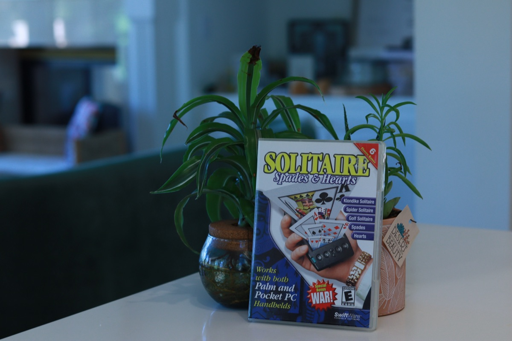
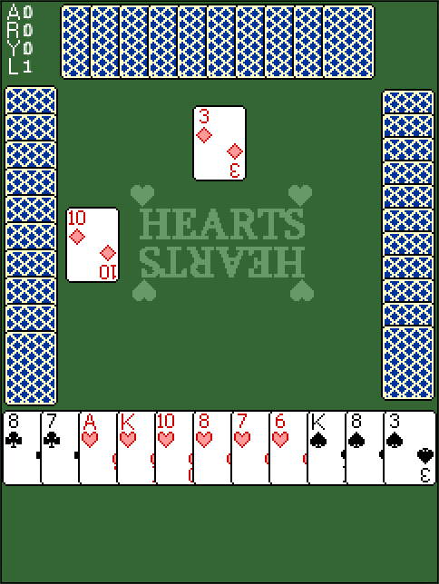
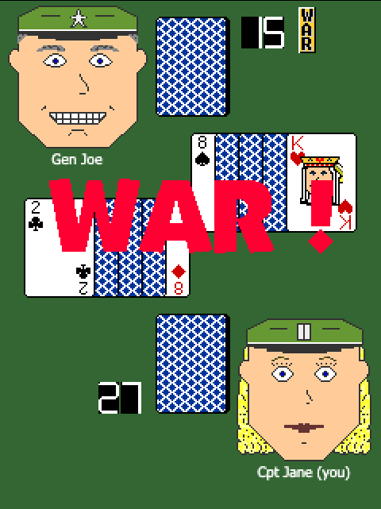

# Card Games To Go, revived

A reverse-engineered revival of **Solitaire and Card Games To Go** (2002, Don Turner /
FixedIt.com): six Pocket PC and Palm card games from a CD-ROM, rebuilt so they run on a modern
machine and in any browser on your LAN.

The games' rules, layouts, sprite composition and computer opponents were recovered by
decompiling the original Windows CE ARM executables with [REA](https://github.com/morluto/rea)
and Ghidra. The notes, with function addresses, are in [FINDINGS.md](FINDINGS.md).

**Play it at [2002solitaire.ozairkhan.com](https://2002solitaire.ozairkhan.com).**

<p align="center">
  <br>
  <em>The CD, found at a garage sale</em>
</p>

<p align="center">
  
  &nbsp;
  <br>
  <em>Hearts and War, running in the browser</em>
</p>

| Game | What came out of the binary |
|---|---|
| Klondike | Shuffle, column-by-column deal, the "first build locks same-suit or alternating colours" rule, one-level undo snapshot, a King-on-Ace quirk caused by Ace being stored as 14 |
| Spider | 1/2/4-suit decks, row-by-row deal, build and suit-completion rules, small-card renderer |
| Golf | Up/down rule with the A↔2 special case and optional Queen-on-King, scoring, LED counters |
| War | 45×63 cards with portrait faces, eight soldier characters, war/draw sequence, sounds |
| Hearts | The full opponent AI: passing, flushing out the Q♠, safe leads, ducking, moon detection and blocking — and that **Hard mode peeks at your hand** |
| Spades | The complete bidding algorithm, including when it bids nil; card play follows the original's structure |

Everything is in the repository: the original disc files (`disc/`), the unpacked executables and
resources (`extracted/`), Ghidra's full decompilation of all six games and REA's output
(`analysis/`), and the bundled art, sounds and help pages (`web/assets/`) so the games play
straight from a clone.

## Play it

All you need is Python 3:

```bash
./serve.py        # prints http://<your-lan-ip>:8002/
```

`tools/extract_assets.py /path/to/disc` regenerates `web/assets/` from an original disc (needs `7z`).

Open that URL on any computer, tablet or phone on your network. Controls: drag cards (or tap
to play in Hearts, Spades, Golf, War), double-tap to send a card to its Klondike foundation,
`N` new game, `U` undo. **Options** has each game's original settings; **Help** shows the
original help page.

### Native Klondike (SDL2)

The first port, kept as a desktop app:

```bash
cd native && make && ./klondike     # make test runs the rules tests
```

## Layout

```
disc/           the original CD contents (Palm .prc, Pocket PC ARM/MIPS/SH3 .CAB, manual)
extracted/      the ARM executables and their resources, unpacked
analysis/       Ghidra decompilation of each game (*.c), PE imports, REA analysis output
web/            browser version (vanilla JS, no build step)
  js/engine.js  sprites with the original colour keys, MS rand(), the original shuffle
  js/*.js       one module per game; tricks.js is the shared Hearts/Spades table
  test/         node web/test/smoke.mjs — plays hundreds of AI hands and checks invariants
native/         C/SDL2 Klondike and its rules tests
tools/          asset extractor, PE import lister, Ghidra bulk-decompile script
serve.py        LAN web server
FINDINGS.md     what the binaries revealed
```

## Reproducing the analysis

```bash
analyzeHeadless /tmp/proj game -import Klondike.009 \
  -scriptPath tools -postScript DecompileAll.java klondike.c
python3 tools/pe_imports.py Klondike.009   # COREDLL ordinals: 535 GetTickCount, 1053 rand, 1061 srand
```

REA was used through its CLI and MCP server with Ghidra 12.1.x and JDK 21
(`GHIDRA_INSTALL_DIR`, `JAVA_HOME`).

The original games, art and sounds are © 2002 Don Turner / FixedIt.com. This is an independent,
non-commercial preservation project, not affiliated with the original author; if you hold rights
to this material and want it removed, please open an issue.
